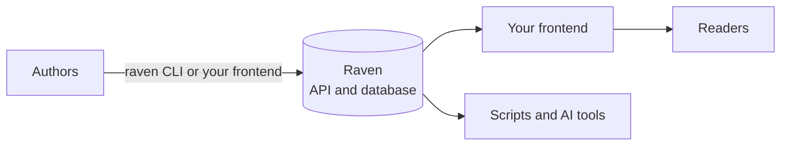

(architecture)=

# Architecture

Raven is a backend with an HTTP API.
It has no website for readers and authors, so every deployment needs a frontend that talks to the API.

- **Raven** stores publications, users, and organizations.
  It runs sign-in and permission checks, registers DOIs, and sends email.
  Its [admin UI](#admins:admin-ui) and the `raven` CLI also talk to Raven through its HTTP API.
- **Raven's backend** needs a MySQL database for publications, users, organizations, and comments, a Postgres database for its job queue, S3-compatible storage for images and media, and a persistent folder (`IMG_DIR`) for avatars.
  There are no published images, so build the backend and admin UI from this repository with `backend-ts/Dockerfile` and `admin-ui/Dockerfile`.
- **Your frontend** serves both authors and readers, with pages for drafting and releasing publications, reading, signing in, commenting, and notifications.
  [thestacks](https://github.com/Astera-org/thestacks) is the frontend of The Stacks, and an example to build on.
- **Rendering** is split between Raven and the frontend, which for The Stacks is thestacks.org.
  For MyST publications, Raven builds a [MyST AST](#developers:myst-publications) and the frontend renders it.
  For [Google Docs publications](#developers:google-docs-publications), the frontend parses and renders the stored Markdown itself.
