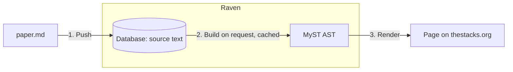

# MyST publications

(developers:myst-publications)=
A MyST publication starts as a Markdown file on an author's machine and ends as a page on a frontend like thestacks.org[^db].
Raven builds the [MyST AST](xref:mystmd#term-myst-ast) from that source when a frontend requests it, and caches the result. The frontend then renders the AST.
MyST is one of The Stacks' two [source formats](xref:thestacks#format:source-format). The [Google Docs format](#developers:google-docs-publications) has a separate authoring path.

[^db]: Raven's database stores the document's source text, not the parsed document / AST. We might change this in the future!

1. **Push.** The [`raven` CLI](./cli.md) sends the file's text.
   Raven's MyST importer ([`importers/mystmd/`](https://github.com/Astera-org/raven/tree/main/importers/mystmd)) reads the frontmatter into the publication's fields, and Raven stores the rest of the file as the body.
2. **Build.** When a frontend asks for the AST, Raven parses the stored source content and builds it into an AST.[^cache]
   Frontends get page AST from Raven's [v1 API](https://api.thestacks.org/api/v1/docs).
3. **Render.** thestacks.org renders the AST with [`myst-to-react`](https://github.com/jupyter-book/myst-theme).

[^cache]: Raven keeps the result in an in-memory cache, so later requests for the same text skip the build.

## How Raven builds the AST

Raven doesn't run `myst build`.
Instead, it calls mystmd's parser and transforms directly ([`backend-ts/src/lib/myst/`](https://github.com/Astera-org/raven/tree/main/backend-ts/src/lib/myst)).
It also adds a few transforms of its own, such as numbering citations to match the publication's reference list.

Raven stores the source rather than the AST, as it does for Google Docs publications.
This reuses the storage Raven already has, and allows the AST's structure to change as mystmd's parser evolves.

The full design, including the contract between Raven and thestacks.org, is in the agent-oriented [`initial-myst-support` skill](https://github.com/Astera-org/raven/blob/main/.agents/skills/initial-myst-support/SKILL.md).

(developers:google-docs-publications)=

## Google Docs publications

Publications imported from Google Docs or created in the web editor take a different path.
Editing a MyST publication in the web editor keeps it MyST, and Raven rebuilds its AST from the edited text.
Raven's imports API ([`POST /api/v1/imports`](https://github.com/Astera-org/raven/blob/main/backend-ts/src/api-v1/routes/imports/post-import.ts)) fetches the Google Doc and converts it with the [`@raven/importer-google-docs-markdown`](https://github.com/Astera-org/raven/tree/main/importers/google-docs-markdown) package.
Raven stores the result as the body, in the Google Docs format (a flavor of Markdown that uses [Google Docs directives](xref:thestacks#format:directives)).
Raven doesn't build an AST for these publications - thestacks.org parses and renders the Markdown itself.
The design is in the agent-oriented [`imports-api` skill](https://github.com/Astera-org/raven/blob/main/.agents/skills/imports-api/SKILL.md).
